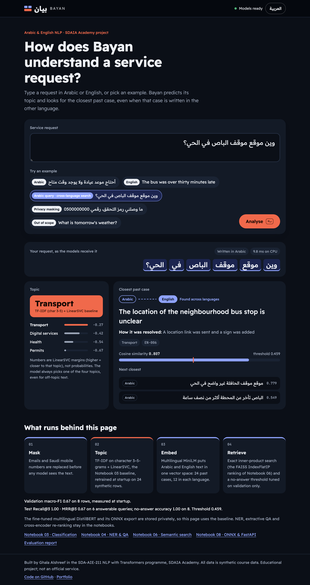

# Try Bayan | جرّب بيان

A one-page demo that answers one question: **how does Bayan understand a service request?**
Type an Arabic or English request (or pick an example). Bayan shows:

1. **Topic**: from the TF-IDF (char 3–5) + LinearSVC baseline of [Notebook 03](../notebooks/03_text_classification.ipynb).
2. **Closest past case**: from multilingual semantic search over 24 synthetic cases, as in [Notebook 06](../notebooks/06_semantic_search.ipynb). An Arabic request can return an English case, and the reverse.
3. **No close case** when the best similarity is below the threshold that was tuned on validation queries only.

Everything runs on CPU and is rebuilt from `data/sample` when the server starts. It needs no Google Drive files, private weights or API keys.



## What is real and what is not

| Shown on the page | Source | Status |
|---|---|---|
| Topic | TF-IDF + LinearSVC, retrained at startup on the 24 `train` rows of `bayan_day2_classification.csv` | Real model. Validation macro-F1 **0.6667** on 8 rows, the same value as Notebook 03. |
| Closest case | `paraphrase-multilingual-MiniLM-L12-v2`, L2-normalised, exact inner-product search over `bayan_day3_cases.csv` | Real model. Produces the same ranking as the FAISS `IndexFlatIP` in Notebook 06. Test Recall@3 **1.0** and MRR@3 **0.667** on 6 answerable queries, with no-answer accuracy **1.0** on 8. These are the same values as `reports/retrieval_metrics.json`. |
| No-answer threshold | Tuned at startup on the 10 validation queries | **0.4592**, the same value as Decision D-004. |
| Privacy step | `bayan.preprocessing.build_text_record` (email and Saudi mobile masking) | Real code. The models never see the raw number or email. |
| Fine-tuned DistilBERT, ONNX FP32/INT8 | Notebooks 03 and 08 | **Not in the demo.** The weights are in a private Drive folder (`/content/drive/MyDrive/bayan/model-v1`), not in GitHub. |
| NER, extractive QA, cross-encoder re-ranking | Notebooks 04 and 06 | Not in the demo; available in the notebooks. |

The page shows the metrics that the server computes when it starts, not hard-coded numbers. All data is synthetic course data. The model can be wrong: for example, «ما وصلني رمز التحقق على الجوال» is predicted as *permit* rather than *digital service*. The page shows that result as it comes out of the model.

## Run it locally

Python 3.10–3.12. Run from the repository root:

```bash
python -m venv .venv && source .venv/bin/activate      # Windows: .venv\Scripts\activate
pip install torch --index-url https://download.pytorch.org/whl/cpu
pip install -r demo/requirements.txt
uvicorn demo.app:app --port 7860
```

Open http://localhost:7860. The topic model is ready in about one second. On the first start the search model (about 470 MB) is downloaded from Hugging Face, so the page shows "Search model loading…" for a short while, and any result on screen refreshes once the model is ready.

To open the page with a request already analysed, use a link such as
`http://localhost:7860/?q=The%20bus%20was%20over%20thirty%20minutes%20late`. Add `&lang=ar` for the Arabic interface.

### With Docker

```bash
docker build -f demo/Dockerfile -t bayan-demo .
docker run -p 7860:7860 bayan-demo
```

The image includes the search model, so the container works without internet once it is built.

## Tests

```bash
PYTHONPATH=src python -m pytest -q                       # light suite, numpy + pytest (unchanged)
PYTHONPATH=src python -m pytest -q demo/test_demo.py     # demo: real models, end to end
```

The demo tests check the recorded metrics, one Arabic request, one English request, an Arabic query that returns an English case, the no-match state, masking, and the 422 responses for invalid input.

## API

| Method | Path | Returns |
|---|---|---|
| `GET` | `/api/status` | Model names, readiness of the search model (`loading` / `ready` / `unavailable`), and the metrics measured at startup |
| `POST` | `/api/analyze` `{"text": "..."}` | Detected language, masked model text, topic with LinearSVC margins, and the top 3 cases with cosine scores, `has_match` and the threshold |

Empty text, text over 1,000 characters and a missing field return `422`. If the search model cannot load, `/api/analyze` still returns the topic and reports search as `unavailable`.

## Publish a public "Try Bayan" link (Hugging Face Spaces, free CPU)

GitHub Pages cannot run Python. A free Hugging Face Docker Space can. It provides 2 vCPU and 16 GB of RAM, which is plenty for this demo.

1. Create a free account at https://huggingface.co.
2. Create a new Space, for example `bayan`. Choose **Docker → Blank** and the free **CPU basic** hardware, and set it to **Public**.
3. Create an access token with **write** permission at https://huggingface.co/settings/tokens. Git asks for it as the password when you push.
4. From the repository root:

   ```bash
   bash demo/make_space.sh ../bayan-space
   cd ../bayan-space
   git init -b main && git add . && git commit -m "Bayan demo"
   git remote add origin https://huggingface.co/spaces/<your-username>/bayan
   git push -f origin main
   ```

5. The Space builds in about 5–10 minutes. Then it is live at `https://<your-username>-bayan.hf.space`.

A free Space goes to sleep after a period with no visitors. The next visitor waits about a minute while it wakes up.
